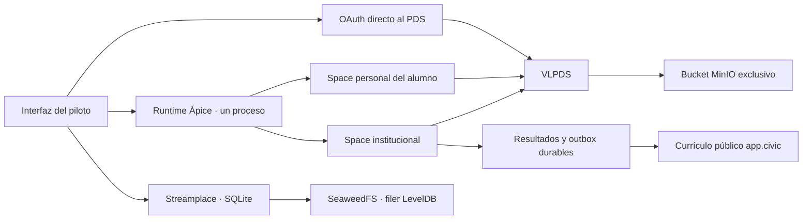

# Piloto aislado de Ápice sobre VLPDS y Spaces

Este paquete implementa el núcleo de aprendizaje sin Prisma, PostgreSQL ni
Redis. **Todavía no es una migración completa del producto ni un piloto de
video aprobado**: falta cerrar el recorrido de subida y reproducción con Streamplace. Los clientes
Expo y Next y el despliegue anterior conservan su backend actual.

Preparación de beta con dominio público y Mac detrás de Cloudflare:
[para-g0v.site](../../docs/BETA_PARA_G0V.md). El modo HTTPS tiene metadata OAuth
confidencial y cookies Secure; su aceptación pública y la integración completa
de clientes todavía están pendientes.

## Arquitectura implementada



- Un Space personal `app.apice.learning`, autoridad del alumno, guarda las
  solicitudes y copias de recibos. El consentimiento OAuth autoriza a Ápice a
  leer/escribir sus colecciones. No se comparte con otros alumnos.
- Un Space `app.apice.institution`, exclusivamente de la institución, guarda
  cursos, claves de evaluación, inscripciones, resultados oficiales,
  constancias y outbox. Cada lectura oficial usa **el repo del DID
  institucional configurado**, nunca una copia controlada por el alumno.
- Se comprueba que los Spaces reutilizados tengan políticas de miembros y
  ningún miembro ajeno. No se cambian permisos preexistentes automáticamente.
  `appAccess=open` permite clientes con consentimiento OAuth del propietario;
  no convierte en público el Space ni sus registros.
- Creación de curso y progreso usan claves de idempotencia. Una clave con otro
  contenido devuelve `409`. Resultado, estado oficial y outbox se escriben en
  **un único `space.applyWrites` del repo institucional**. No se promete una
  transacción entre Spaces.
- El request del alumno se guarda antes de procesarlo. Una caída entre commits
  se recupera reenviando exactamente el mismo comando. La copia personal del
  resultado es de mejor esfuerzo; el reintento la vuelve a entregar. No hay
  un worker independiente para solicitudes personales abandonadas.
- La publicación del currículo es una outbox durable con TIDs y timestamps
  estables. Sólo publica `app.civic.course` y `app.civic.lesson`, con referencias
  fuertes al video. Las respuestas correctas no forman parte del registro
  público ni de la respuesta de catálogo.
- Las lecciones se desbloquean secuencialmente, el avance nunca retrocede y
  los quizzes se califican en el runtime institucional. El tiempo de video
  es autorreportado: no equivale a supervisión de un examen.
- Una acción separada, con consentimiento explícito, publica únicamente una
  finalización `app.civic.progress` desde el repo público del alumno. No
  publica notas, respuestas, historial ni una constancia institucional.
- El catálogo en memoria se reconstruye por `space.listRecords`, entre dos
  lecturas de revisión iguales. No depende de Jetstream ni de retención del
  oplog. No implementa todavía sincronización federada por credenciales
  Spaces, verificación CAR/LtHash ni un índice de toda la red.
- Una sola instancia de Ápice es el escritor institucional. No ejecutar dos
  instancias con el mismo DID: Spaces no proporciona el CAS de aplicación
  entre procesos que haría falta para ello.
- El repo institucional tiene el límite de registros de Spaces (100.000 por
  defecto en el pin). Solicitudes y recibos también lo consumen: este diseño
  es para una cohorte pequeña, y requiere partición/retención antes de escalar.
  Reconstruir snapshots completos simplifica la recuperación a cambio de
  lecturas y coste de almacenamiento; no hereda automáticamente la escala de
  VLPDS para las consultas de Ápice.

## Versiones y alcance

- VLPDS: [fork mexico-parasocial, revisión e215170](https://github.com/mexico-parasocial/vlpds/tree/e215170d27d65b3360a8bd0904bf53a29c0c848b).
  El pin corresponde a ese fork, no a una revisión publicada de jazware con
  el mismo hash. Contratos Spaces incluidos: alpha ATProto
  `5b95b2f2723a2882824fbb0b819fd6aad884ef20`. Para pruebas reproducibles usar el
  checkout limpio fijado, no un binario de un checkout con cambios locales.
- Streamplace v0.11.13: SQLite para `state.sqlite` **y** `localdb.sqlite`.
  Imagen del proyecto existente; package ID `789` para ARM64, `786` para AMD64.
- SeaweedFS 4.42, imagen fijada por digest, filer `leveldb2` persistente.
- Dockerfile MinIO fija revisiones de sus releases de octubre/agosto de 2025.
  Se puede proporcionar `PILOT_MINIO_IMAGE` para una imagen local verificada.
- OAuth propio del piloto: PAR + PKCE + DPoP, issuer y PDS fijados por
  configuración, cookie HttpOnly y estado ligado al navegador. La aplicación
  sólo escucha en loopback. No es un cliente OAuth general de producción.
- Sesiones OAuth y cookies de Ápice en memoria. Tras reiniciar, la institución
  vuelve a iniciar sesión para reconstruir el catálogo y reanudar la outbox;
  los alumnos también vuelven a entrar. No se almacenan contraseñas de
  alumnos en el runtime. `setup` crea exclusivamente fixtures locales y deja
  sus credenciales de prueba en un archivo ignorado con permisos `0600`.
- Sin INE, cobros, migración de cuentas, notas históricas ni expedientes reales.
  Las constancias privadas son registros del piloto, no VCs/credenciales iM8.

Spaces es experimental y el operador del PDS puede leer sus datos. Las copias
de cuenta ZIP no incluyen todo Spaces: respaldar bucket, claves y los otros
cuatro volúmenes. Ver [privacidad de VLPDS](https://vlpds.jazco.dev/docs/spaces/privacy)
y [operación de Spaces](https://vlpds.jazco.dev/docs/spaces/operating).

## Arranque local

Desde la raíz del repositorio:

```sh
pnpm install --filter @apice/pilot
pnpm pilot:infra
```

Esto crea **apice-spaces-pilot**, una red y cinco volúmenes separados. Nunca
combinar este Compose con los anteriores mediante múltiples `-f`.
Puertos: MinIO `2595`, PDS `2593`, Ápice `8010`, Streamplace `38093`, todos
publicados en loopback. El feed de Streamplace apunta al PDS del piloto, no
al firehose público global. Los secretos de Compose son únicamente fixtures
de prueba de este despliegue local.

La API directa de Streamplace se publica internamente en `38094`. El nuevo
adaptador `media-server.mjs` mantiene el origen público `38093`, sirve su
callback OAuth y reenvía las rutas del nodo. Arrancarlo en una terminal
adicional para conservar ese origen y comprobar el acceso de una cuenta
Bluesky autorizada:

```sh
node packages/pilot/scripts/pin-media-key.mjs
PILOT_MEDIA_HANDLE=tu-cuenta.bsky.social \
PILOT_MEDIA_DID=did:plc:DID_VERIFICADO pnpm --filter @apice/pilot media
```

Abrir `http://127.0.0.1:38093/pilot/`. El adaptador recibe únicamente tokens
emitidos por el proxy del nodo. La contraseña se introduce en `bsky.social`;
no hay una entrada de contraseña en Ápice ni se guarda en su configuración.
Verifica firma JWT, emisor, audiencia, DID, caducidad y clave DPoP, y limita
los endpoints utilizables. Por ahora la pantalla ofrece sólo la comprobación
de sesión, sin iniciar un upload ni publicar registros.

v0.11.13 anuncia `/oauth/jwks` pero esa ruta devuelve 404. El script anterior
extrae únicamente la clave pública de acceso desde el volumen aislado del
nodo, con montaje de sólo lectura y sin red. El adaptador fija esa clave en
`.local/streamplace-public-jwks.json`; nunca exporta la clave privada ni las
sesiones de OAuth. Si se recrea el estado del nodo hay que repetir ese paso.

El alcance que pide v0.11.13 incluye perfil, seguimientos, bloqueos y otras
operaciones de Bluesky además de video. Se requiere revisar ese consentimiento
para una cuenta real. El cliente local incluido en esa versión también fija
parte del transporte a `127.0.0.1:38080`; el adaptador usa el destino configurado.
La autorización real y una consulta autenticada del nodo ya pasaron con el
consentimiento explícito del propietario. El recorrido de subida completo
sigue pendiente; la prueba de sesión no publica registros.

Para ejecutar VLPDS nativamente, construir el checkout limpio fijado:

```sh
git clone https://github.com/mexico-parasocial/vlpds.git packages/pilot/.local/vlpds
git -C packages/pilot/.local/vlpds checkout --detach e215170d27d65b3360a8bd0904bf53a29c0c848b
cd packages/pilot/.local/vlpds
cargo build --locked --bin vlpds --bin vlpds-bucket-probe
cd ../../../..
VLPDS_BIN="$PWD/packages/pilot/.local/vlpds/target/debug/vlpds" bash packages/pilot/scripts/pds-native.sh
```

Alternativa: `docker compose -f packages/pilot/infra/compose.yaml --profile
container-pds up -d --build pds`. Elegir una sola opción de PDS. El perfil
Docker compila el pin; puede tardar. En equipos AMD64, para la imagen de
Streamplace usar package ID `786` e imagen con nombre propio, sin reutilizar
una imagen ARM64.

En otra terminal:

```sh
pnpm --filter @apice/pilot setup
pnpm pilot
```

Abrir [el piloto](http://127.0.0.1:8010/). Los handles y contraseñas **de
prueba** están en `packages/pilot/.local/test-accounts.json`. Iniciar primero
como institución marcando la casilla correspondiente. Para probar alumno,
usar otra sesión de navegador o salir y entrar con su handle. La recuperación
de cuenta pertenece al PDS; el piloto no envía correo ni implementa un segundo
flujo de recuperación. iM8 no es requisito.

## Validación

```sh
pnpm --filter @apice/pilot check
pnpm pilot:test
pnpm --filter @apice/pilot doctor
PILOT_TEST_PDS_URL=http://127.0.0.1:2593 pnpm --filter @apice/pilot test:live
VLPDS_BIN="$PWD/packages/pilot/.local/vlpds/target/debug/vlpds" \
  PILOT_TEST_S3_ENDPOINT=http://127.0.0.1:2595 pnpm --filter @apice/pilot test:durability
PILOT_TEST_PDS_URL=http://127.0.0.1:2593 \
  PILOT_TEST_STREAMPLACE_URL=http://127.0.0.1:38093 pnpm --filter @apice/pilot test:media-auth
```

`test:live` prueba OAuth y Spaces reales con referencias de video de fixture;
no prueba reproducción ni transcodificación. `test:durability` usa un prefijo
nuevo en el bucket exclusivo, puerto `2594`, mata **su propio proceso** con
SIGKILL y comprueba recuperación e idempotencia con un índice nuevo. Espera
posesión de shards después del reinicio, no sólo `_health`.
`test:media-auth` comprueba que un token Bearer del PDS no concede acceso a
uploads del nodo; **no es una prueba de subida exitosa**.

El preflight de bucket requiere PUT condicional/CAS y debe ejecutarse sólo
contra el bucket del piloto. Ejemplo (el probe limpia su propio prefijo):

```sh
packages/pilot/.local/vlpds/target/debug/vlpds-bucket-probe \
  --s3-endpoint http://127.0.0.1:2595 --s3-bucket apice-pilot-pds \
  --s3-access-key apice-pilot-only --s3-secret-key apice-pilot-test-secret \
  --skip-latency --json packages/pilot/.local/bucket-probe.json
```

## Pendiente que bloquea el recorrido completo de video

La prueba real de `place.stream.media.createUpload` devolvió `401` con
`oauth session required` al usar un Bearer del PDS. En v0.11.13,
`oatproxy.GetOAuthSession` exige una sesión del **proxy de Streamplace**.
Tampoco basta con apuntar un cliente OAuth del PDS a una URL absoluta del
nodo: la clave debe existir en el proxy y el token debe haber sido emitido
por éste. Por tanto, el CLI anterior de `server/scripts/publish-lesson-video.ts`
y el supuesto del cliente de admin no constituyen una subida verificada.

Además, el proxy fijado por esa versión tiene URLs HTTPS y resolución pública
de DIDs en su implementación. El PDS de este piloto es HTTP y usa DIDs locales
sin registrar. Es necesario resolver esa compatibilidad mediante un cliente
de Streamplace y entorno de identidad soportados, o una adaptación del proxy
con pruebas. No aceptar cualquier token del PDS ni insertar sesiones en SQLite
para saltarse el flujo.

Para una cuenta real con PDS público HTTPS, el adaptador ya resuelve la
identidad y alcanza la pantalla de consentimiento de Bluesky. Esta vía no
añade soporte Spaces al PDS de Bluesky: los datos de aprendizaje siguen en el
VLPDS aislado del piloto.

Fuentes verificadas:
[control de upload](https://github.com/streamplace/streamplace/blob/4445e3e0013bcf3fce6e438a1c51933ec1326df3/pkg/spxrpc/place_stream_media.go),
[proxy OAuth](https://github.com/streamplace/oatproxy/tree/f8852e8dbf44),
[emisión de video](https://github.com/streamplace/streamplace/blob/4445e3e0013bcf3fce6e438a1c51933ec1326df3/pkg/vod/publish_video.go).

El formulario de curso ya exige URI/CID local válido y playlist HLS accesible;
no permite sustituir esto por una URL de fixture para dar por buena la prueba.
La interfaz reproduce HLS nativo o con hls.js. Falta demostrar con un video
real: OAuth del nodo → TUS → transcodificación → publicación → vinculación →
reproducción → evaluación → constancia. También falta probar restauración de
video y blobs, no sólo metadatos.

## Backups y restauración

Detener primero el runtime Ápice y su PDS nativo. Después:

```sh
bash packages/pilot/scripts/backup.sh
bash packages/pilot/scripts/restore.sh /ruta/absoluta/al/backup
```

El backup detiene los servicios del Compose y copia los cinco volúmenes en
reposo con checksums. Los deja detenidos hasta reinicio explícito. Restaurar
siempre crea volúmenes nuevos bajo `apice-spaces-pilot-restore`; nunca pisa los
del piloto ni los anteriores. No inicia servicios. Los secretos de VLPDS,
credenciales de objetos y el pin de software deben conservarse para poder
arrancar la restauración con los mismos parámetros.

La prueba `test/restore.mjs`, con `PILOT_RESTORE_TEST=prepare` antes del backup
y `PILOT_RESTORE_TEST=verify` contra el PDS restaurado, comprueba DID y un
registro privado con un nonce externo al backup. Para una instancia MinIO
restaurada en otro puerto, `scripts/pds-native.sh` admite
`PILOT_S3_ENDPOINT=http://127.0.0.1:2596`. Consultar el
[estado verificado](../../docs/VLPDS_PILOT_STATUS.md) para distinguir metadatos
recuperados de reproducción de video todavía pendiente.

## iM8

Se preserva su lugar como opción de acceso y presentación de credenciales.
En esta iteración no se integra su broker: no concede por sí solo una sesión
de escritura en Spaces. Antes de conectarlo hay que verificar DID, emisor,
audiencia, alcance, expiración y revocación, y conseguir una delegación que el
PDS acepte. No se admiten identidades `localOnly` como prueba de autenticación.
La wallet y emisión de credenciales verificables quedan para una fase aparte.

Beneficio previsto: reutilizar identidad y, después, llevar acreditaciones a
otras aplicaciones. Coste: otro servicio de confianza, manejo de claves,
recuperación y compatibilidad con Spaces alpha. Mantener OAuth directo evita
que ese servicio sea un punto obligatorio de fallo.
